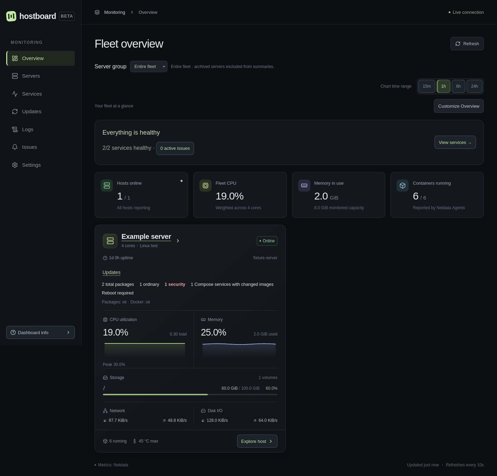

# Hostboard

> Use v0.5.3 for the monitoring reliability fixes. The initial v0.5.0 image has a local-login defect; v0.5.1 fixes it while retaining strict CSRF protection. Existing Cloudflare Access deployments are unaffected.

A self-hosted dashboard for servers monitored by **Netdata Agents**. View live metrics, historical charts, Docker resources, Netdata alerts, service availability, and persistent incidents in one place.

Hostboard queries existing Agents directly. It does not replace Netdata's collectors, metric storage, retention, or alert engine, and does not require Netdata Cloud. Its own SQLite database stores service checks, incidents, notification delivery state, and application preferences.



- Multiple servers, filesystem capacity, temperatures, network and disk throughput.
- Historical metric investigation, diagnostics, container resources, and alert history.
- HTTP/TCP service checks, outage/recovery tracking, and optional SMTP notifications.
- Customizable Overview layout and browser preferences.
- Local administrator login or existing Cloudflare Access JWT verification.
- Published Docker images for Linux amd64 and arm64; one application container and SQLite.

## Quick installation

Requires Linux, Git, Docker Engine with Compose v2, and at least one reachable Netdata Agent supporting `/api/v3/nodes`, `/api/v3/contexts`, `/api/v3/data`, and `/api/v3/alerts`. You do not need Node.js or Python to run the published image. Allow roughly 384 MiB for the container and space for your chosen service-history retention.

```sh
git clone https://github.com/KLCaron/hostboard.git
cd hostboard
git checkout v0.5.3
./scripts/setup.sh
./scripts/setup.sh --check
docker compose up -d --wait
```

The setup CLI uses the published image. It prompts for the browser URL, published interface/port, data directory, Agent endpoints and exact node selectors, administrator credentials, and optional SMTP. It creates private configuration with restricted permissions and never opens a setup web server. Repeating setup preserves existing files; `--check` validates them. The wrapper supports data directories inside the project; for an absolute external directory, use the [additional setup bind mount](docs/installation.md#external-data-directories).

By default, open **http://localhost:8088** on the Docker host and sign in with the credentials you chose. From another machine, use an SSH tunnel:

```sh
ssh -L 8088:127.0.0.1:8088 your-docker-host
```

Then open the same localhost URL. For direct remote access, configure an HTTPS reverse proxy and an explicit trusted proxy IP; see [installation](docs/installation.md) and [authentication](docs/authentication.md). Never use a default password or publish an unprotected Cloudflare origin.

**Container networking matters:** `127.0.0.1` in the default container refers to the container. Use an Agent's private address, a shared Docker network name, or `host.docker.internal` when the Agent accepts connections on the host bridge interface. A loopback-only host Agent needs the optional Linux host-network configuration. See [Docker networking](docs/networking.md).

## Connect and add servers

The CLI writes `config/hosts.json`:

```json
{
  "hosts": [
    { "id": "server-a", "name": "Server A", "url": "http://agent.internal.example:19999", "node": "server-a" }
  ]
}
```

The exact `node` must appear as a hostname, machine GUID, or node UUID in that Agent's `/api/v3/nodes` response. An Agent may be a streaming parent serving multiple nodes. Add further entries to this file and recreate Hostboard:

```sh
docker compose up -d --force-recreate --wait
```

Hostboard validates configuration at startup. An unavailable Agent appears offline with a connection error; other hosts and the dashboard still work. Keep Agent APIs private and allow only Hostboard's source network. Historical retention belongs to Netdata, so upgrading Hostboard does not move or backfill metrics.

## Administration and notifications

Local login protects the dashboard and APIs with a single explicit administrator account. HTTPS sessions use Secure, HttpOnly, SameSite cookies and expire after one hour; restarting signs local users out. Passwords are stored as Argon2id hashes. Cloudflare Access remains supported with an explicit email allowlist and verified issuer/audience/signature. Read-only Cloudflare origins require a trusted network or Access proxy protecting **all paths**. [Authentication details](docs/authentication.md).

Add, test, disable, or archive HTTP/TCP checks in **Settings → Services**. First approve exact destinations and IP addresses in deployment-managed `private/admin.json`. Arbitrary URL probing is blocked. [Service checks](docs/service-checks.md).

SMTP is optional. Configure `private/smtp.json` during setup or from the [SMTP example](config/smtp.example.json), then recreate the container. Settings controls recipients, severity, cooldown, recovery, and a rate-limited test email. Netdata notifications and an optional independent watchdog remain separately operated. [Configuration reference](docs/configuration.md).

## Backup, upgrade and recovery

```sh
./scripts/manage.sh backup ./backups/manual
# After reviewing a newer release, substitute its exact version or digest:
./scripts/manage.sh upgrade ghcr.io/klcaron/hostboard:0.5.3 ./backups/before-upgrade
# Restore the paired image, configuration, and database if necessary:
./scripts/manage.sh rollback ./backups/before-upgrade
```

Backups contain credentials and should be copied securely off-host. The helper uses SQLite's online backup API, pulls the chosen image, restarts only Hostboard, and waits for container health. Restoration stops Hostboard and restores a matching database/configuration checkpoint. It discards observations made after that checkpoint. Never open an upgraded database with an older image unless compatibility is verified. [Upgrade and rollback guide](docs/operations.md).

## Documentation and support

[Installation](docs/installation.md) · [Networking](docs/networking.md) · [Authentication / Cloudflare Access](docs/authentication.md) · [Configuration](docs/configuration.md) · [Service checks](docs/service-checks.md) · [Operations](docs/operations.md) · [Troubleshooting](docs/troubleshooting.md) · [Security](SECURITY.md) · [Contributing](CONTRIBUTING.md)

Report bugs and feature requests in [GitHub Issues](https://github.com/KLCaron/hostboard/issues). Include the Hostboard version, sanitized configuration, browser, and relevant logs. Do not post credentials, tokens, real monitoring endpoints, or database backups. Follow [SECURITY.md](SECURITY.md) for sensitive reports.

## License

Hostboard is **AGPL-3.0-only**; see [LICENSE](LICENSE). If you modify and provide Hostboard over a network, offer users the corresponding source as required by the license. Releases link to their source commit. Dependencies retain their own compatible licenses and notices; see [third-party notices](THIRD_PARTY_NOTICES.txt) and [dependency review](docs/dependencies.md). Screenshots show the actual application using synthetic test data and generic names.
