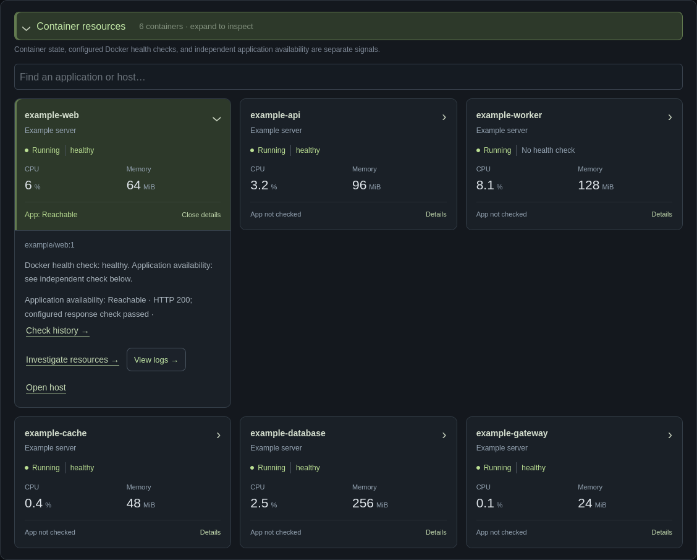
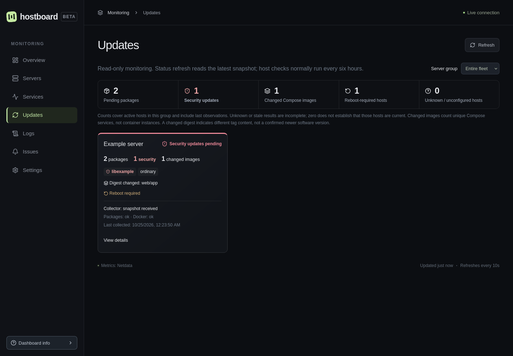

# Hostboard

A self-hosted dashboard for servers monitored by **Netdata Agents**. View live metrics, historical charts, Docker resources, Netdata alerts, service availability, persistent incidents, and update inventories in one place.

**Version scope:** this README describes `main` (0.9.0). The latest [published release is v0.7.1](https://github.com/KLCaron/hostboard/releases/latest). Update Monitor, issue handling, container cards, and the newest dependency fixes are on `main` and are not included in that published image. To run the current code, use the [source-build instructions](docs/installation.md#build-from-source). Do not assume a `0.9.0` registry image exists just because that version appears in the source defaults.

Hostboard queries existing Agents directly. It does not replace Netdata's collectors, metric storage, retention, or alert engine, and does not require Netdata Cloud. Its own SQLite database stores server registrations, service checks, incidents, issue-handling rules, notification delivery state, and application preferences.


- Multiple servers, filesystem capacity, temperatures, network and disk throughput.
- Historical metric investigation, diagnostics, expandable container cards, and alert history.
- Register, discover, group, and manage existing Netdata Agents in Settings.
- Optional Docker logs with time windows, search, live tail and incident navigation through a restricted SSH adapter.
- HTTP/TCP service checks, outage/recovery tracking, and optional SMTP notifications.
- Acknowledge, snooze, ignore, and restore individual issues while retaining observations and history.
- Read-only package, reboot, and Docker image update inventories through optional host collectors.
- Customizable Overview layout and browser preferences.
- Local administrator login or existing Cloudflare Access JWT verification.
- Published Docker images for Linux amd64 and arm64; one application container and SQLite.

## Published-release installation

This installs **v0.7.1** and its release-specific feature set. For the current `main` features and dependency fixes, [build from source](docs/installation.md#build-from-source) instead. Use the documentation from the version you check out when operating a release.

Requires Linux, Git, Docker Engine with Compose v2, and at least one reachable Netdata Agent supporting `/api/v3/nodes`, `/api/v3/contexts`, `/api/v3/data`, and `/api/v3/alerts`. You do not need Node.js or Python to run the published image. Allow roughly 384 MiB for the container and space for your chosen service-history retention.

```sh
git clone https://github.com/KLCaron/hostboard.git
cd hostboard
git checkout v0.7.1
./scripts/setup.sh
./scripts/setup.sh --check
docker compose up -d --wait
```

The setup CLI uses the published image. It prompts for the browser URL, published interface/port, data directory, Agent endpoints and exact node selectors, administrator credentials, and optional SMTP. It creates private configuration with restricted permissions and never opens a setup web server. Repeating setup preserves existing files; `--check` validates them. The wrapper supports data directories inside the project; for an absolute external directory, use the [additional setup bind mount](docs/installation.md#external-data-directories).

By default, open **http://localhost:8088** on the Docker host and sign in with the credentials you chose. From another machine, use an SSH tunnel:

```sh
ssh -L 8088:127.0.0.1:8088 your-docker-host
```

Then open the same localhost URL. For direct remote access, configure an HTTPS reverse proxy and an explicit trusted proxy IP; see [installation](docs/installation.md) and [authentication](docs/authentication.md). Never use a default password or publish an unprotected Cloudflare origin.

**Container networking matters:** `127.0.0.1` in the default container refers to the container. Use an Agent's private address, a shared Docker network name, or `host.docker.internal` when the Agent accepts connections on the host bridge interface. A loopback-only host Agent needs the optional Linux host-network configuration. See [Docker networking](docs/networking.md).

## Connect and add servers

The CLI writes `config/hosts.json`:

```json
{
  "hosts": [
    { "id": "server-a", "name": "Server A", "url": "http://agent.internal.example:19999", "node": "server-a" }
  ]
}
```

The exact `node` must appear as a hostname, machine GUID, or node UUID in that Agent's `/api/v3/nodes` response. An Agent may be a streaming parent serving multiple nodes. This file bootstraps the persistent server registry once; later edits do not add or update registered servers.

For additional servers, approve the exact Agent origin and IP addresses in deployment-managed `private/agents.json`, restart Hostboard to load that policy, then use **Settings → Servers → Add server**. Test the connection, select the exact node, and save it. Administrators can also rename, group, disable, archive, and restore servers there. See [server connections, approval, and migration](docs/servers.md).

Hostboard validates configuration at startup. An unavailable Agent or disconnected streamed child appears offline; reachable nodes without fresh samples appear stale. Other hosts and the dashboard continue reporting independently. Keep Agent APIs private and allow only Hostboard's source network. Historical retention belongs to Netdata, so upgrading Hostboard does not move or backfill metrics.

## Read the dashboard

**Overview** summarizes the fleet; **Servers** provides per-host metrics, diagnostics, and history. Host alert counts link to that server's active metric issues. **Services** shows independent application checks and a searchable grid of container cards. Each card separates Docker state/health from application reachability and expands for resource investigation and log links. New containers can appear through Netdata without automatically gaining application checks or approved log access. [Service and container signals](docs/service-checks.md#container-resources).



In **Issues**, administrators can acknowledge one occurrence, snooze a condition, or treat it as expected. The **Handled** tab records the reason and operator and lets you restore the alert. Handling changes Hostboard's active list, counts, and matching service-check emails; collection and incident history continue. It does not change Netdata, Netdata Cloud, or watchdog notification settings. [Issue-handling behavior](docs/operations.md#handling-individual-issues).

## Administration and notifications

Local login protects the dashboard and APIs with a single explicit administrator account. HTTPS sessions use Secure, HttpOnly, SameSite cookies and expire after one hour; restarting signs local users out. Passwords are stored as Argon2id hashes. Cloudflare Access remains supported with an explicit email allowlist and verified issuer/audience/signature. Read-only Cloudflare origins require a trusted network or Access proxy protecting **all paths**. [Authentication details](docs/authentication.md).

Add, test, disable, or archive HTTP/TCP checks in **Settings → Services**. First approve exact destinations and IP addresses in deployment-managed `private/admin.json`. Arbitrary URL probing is blocked. [Service checks](docs/service-checks.md).

SMTP is optional. Configure `private/smtp.json` during setup or from the [SMTP example](config/smtp.example.json), then recreate the container. Settings controls recipients, severity, cooldown, recovery, and a rate-limited test email. Netdata notifications and an optional independent watchdog remain separately operated. [Configuration reference](docs/configuration.md).

## Optional container logs

Read approved Docker stdout/stderr from container and service details, or open related logs around an incident. All log APIs require server-side administrator authorization. The optional forced-command SSH adapter runs on each Docker host; the main application never mounts a Docker socket. No new port or log-storage stack is required. Review the [setup, privilege boundary and limitations](docs/logs.md) before enabling it.

## Optional Update Monitor

**Updates** shows package/security candidates, reboot flags, changed Compose image content, and collection freshness. **Settings → Updates** controls snapshot-read timing and per-host preferences. This requires the [optional collector and restricted SSH reader](docs/updates.md); Netdata alone does not supply the inventory. **Refresh Status** rereads the existing snapshot and does not run a collector, install packages, pull images, or restart services. Registry additions in Settings are proposals for an operator to review and apply on the host.



## Backup, upgrade and recovery

```sh
./scripts/manage.sh backup ./backups/manual
# After reviewing a newer release, substitute its exact version or digest:
./scripts/manage.sh upgrade ghcr.io/klcaron/hostboard:0.7.1 ./backups/before-upgrade
# Restore the paired image, configuration, and database if necessary:
./scripts/manage.sh rollback ./backups/before-upgrade
```

Backups contain credentials and should be copied securely off-host. The helper uses SQLite's online backup API, pulls the chosen image, restarts only Hostboard, and waits for container health. Restoration stops Hostboard and restores a matching database/configuration checkpoint. It discards observations made after that checkpoint. Never open an upgraded database with an older image unless compatibility is verified. [Upgrade and rollback guide](docs/operations.md).

## Documentation and support

[Installation](docs/installation.md) · [Server management](docs/servers.md) · [Networking](docs/networking.md) · [Authentication / Cloudflare Access](docs/authentication.md) · [Configuration](docs/configuration.md) · [Service checks](docs/service-checks.md) · [Operations and issue handling](docs/operations.md) · [Container logs](docs/logs.md) · [Update Monitor](docs/updates.md) · [Troubleshooting](docs/troubleshooting.md) · [Security](SECURITY.md) · [Contributing](CONTRIBUTING.md)

Report bugs and feature requests in [GitHub Issues](https://github.com/KLCaron/hostboard/issues). Include the Hostboard version, sanitized configuration, browser, and relevant logs. Do not post credentials, tokens, real monitoring endpoints, or database backups. Follow [SECURITY.md](SECURITY.md) for sensitive reports.

## License

Hostboard is **AGPL-3.0-only**; see [LICENSE](LICENSE). If you modify and provide Hostboard over a network, offer users the corresponding source as required by the license. Releases link to their source commit. Dependencies retain their own compatible licenses and notices; see [third-party notices](THIRD_PARTY_NOTICES.txt) and [dependency review](docs/dependencies.md). Screenshots show the actual application using synthetic test data and generic names.
